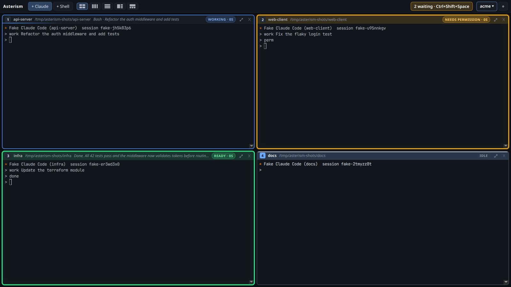
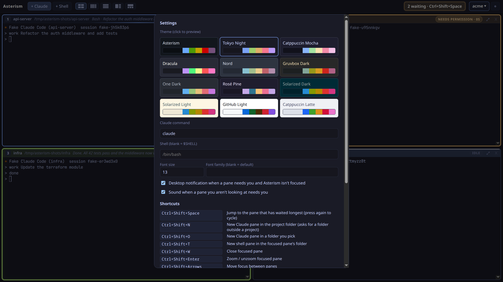

<p align="center">
  
</p>

<h1 align="center">Asterism</h1>

<p align="center">
  A tiled terminal for running many Claude Code sessions at once,<br>
  with a status light on every pane so you always know which one needs you.
</p>

<p align="center">
  
</p>

## Why

Running four or more Claude Code sessions in separate terminal windows means constantly checking
each one to see if it has finished or is stuck on a prompt. Other multi-agent tools hide sessions
behind tabs or replace Claude Code with their own agent. Asterism keeps the real `claude` CLI in a
real terminal and puts every session on screen at once, built for a big monitor.

## Features

- **A status light on every pane**, driven by Claude Code's own hooks rather than guessing from the
  screen:

  | Border | Meaning |
  |---|---|
  | **Solid green** | Claude finished and is waiting for you. It stays green until you type in that pane. |
  | **Pulsing amber** | Blocked: a permission prompt, a question, or plan approval. |
  | **Red** | An API error ended the turn. |
  | **Blue** | Working. The title bar shows the current tool and prompt. |
  | Dashed amber | No hook events yet, e.g. Claude is showing its "trust this folder?" prompt. |
  | Grey | Idle, a plain shell, or still starting. |

- **Jump to whoever's waiting.** `Ctrl+Shift+Space` goes to the pane that has waited longest, blocked
  panes first. Press again to cycle. When the window isn't focused you can get a desktop
  notification and a sound.
- **Panes can see each other.** Ask a pane *"what are the other panes doing?"* and Claude uses
  Asterism's built-in, read-only MCP tools: `list_panes`, `get_pane_transcript` and
  `read_pane_screen`. Panes can't type into each other.
- **Layouts:** grid (four panes = four corners), columns, rows, main + stack and main + row. Drag
  dividers to resize, and drag title bars to swap panes.
- **Projects:** a project is a name, a folder and its panes. Inside a project, `Ctrl+Shift+N` opens
  Claude in the project folder straight away. The layout saves as you work, so switching projects
  and back restores every pane with its conversation resumed. Tick *Reopen the last project at
  startup* in ⚙ Settings to have that happen when Asterism opens, too.
- **12 themes**, 9 dark and 3 light, with live preview. Each theme recolours both the window and
  the terminals.
- **Works with your setup.** Your shell, your startup files and your `~/.claude/settings.json` are
  left as they are. A `claude` you type yourself in any pane is tracked too.

<p align="center">
  
</p>

## Install

Download the AppImage (Linux) or the portable `.exe` (Windows) from
[Releases](https://github.com/evoluketion/asterism/releases). On Linux, make it executable first:
`chmod +x Asterism-*.AppImage`. You can also build it yourself:

### Linux (AppImage)

```bash
npm install
npm run dist:linux
./dist/Asterism-0.1.0.AppImage
```

Copy the AppImage anywhere you like, e.g. `~/Applications`. The first build needs a C++ toolchain
(`gcc-c++ make python3`) for node-pty.

### Windows

```powershell
npm install
npm run dist:win
```

This builds a portable `Asterism-<version>.exe` in `dist/`: no install, just run it, like the
AppImage. Windows uses node-pty's prebuilt ConPTY binaries, so no build tools are needed. *The Windows build hasn't been tested yet.*

### From source

Requirements: Node 20+, npm, and `claude` on your PATH.

```bash
npm install
npm start
```

## Using it

1. Click **No project ▾** at the top right and create a project: pick a folder and give it a name.
2. Press `Ctrl+Shift+N` a few times. Each press opens a Claude pane in the project folder.
3. Work as normal. When a border turns green or amber, that pane wants you, and
   `Ctrl+Shift+Space` takes you there.

Outside a project, `Ctrl+Shift+N` asks for a folder each time. `Ctrl+Shift+O` (or **+ Claude**)
always opens the folder picker, with recent folders, an optional pane name and extra `claude`
arguments such as `--model opus`.

You can `/exit`, `cd` somewhere else and run `claude` again in any pane; the pane keeps its status
light and renames itself after the new folder. When a pane's process exits, press Enter to restart
it, and a Claude pane resumes its conversation.

To rename a pane, right-click its title bar, double-click its name or press `Ctrl+Shift+R`. The
name is saved with the project. Clear the name to go back to the folder name.

### Shortcuts

| Shortcut | Action |
|---|---|
| `Ctrl+Shift+Space` | Jump to the pane that has waited longest |
| `Ctrl+Shift+N` | New Claude pane in the project folder (asks for a folder outside a project) |
| `Ctrl+Shift+O` | New Claude pane in a folder you pick |
| `Ctrl+Shift+T` | New shell pane in the focused pane's folder |
| `Ctrl+Shift+W` | Close pane |
| `Ctrl+Shift+Enter` | Zoom / unzoom |
| `Ctrl+Shift+Arrows` | Move focus |
| `Ctrl+Shift+1…9` | Focus pane by number |
| `Ctrl+Tab` / `Ctrl+Shift+Tab` | Next / previous pane |
| `Ctrl+Shift+L` | Cycle layout |
| `Ctrl+Shift+R` | Rename pane |
| `Ctrl+Shift+F` | Search scrollback |
| `Ctrl+Shift+C` / `V`, right-click | Copy / paste |
| `Ctrl+Shift+=` / `-` | Font size |
| `Shift+Enter` | Newline in the Claude prompt |
| `Ctrl+Shift+H` | Hide / show the toolbar. When it's hidden, hover the top edge to slide it down. |
| `F11` | Fullscreen |

Shortcuts use `Ctrl+Shift` so they never take a key a program in the pane might need.

### Themes

Asterism, Tokyo Night, Catppuccin Mocha, Dracula, Nord, Gruvbox Dark, One Dark, Rosé Pine,
Solarized Dark, Solarized Light, GitHub Light and Catppuccin Latte. Pick one in ⚙ Settings. With a
light theme, also run `/theme` in Claude Code and choose a light option, so Claude's own text
colours stay readable.

## How it works

- **Hooks, not screen scraping.** Each pane gets a small `claude` wrapper first on its PATH, which
  runs the real CLI as `claude --settings <pane>/settings.json --mcp-config <pane>/mcp.json`. Those
  settings add Claude Code [hooks](https://code.claude.com/docs/en/hooks) that report each event
  to a small HTTP server inside Asterism. The events are prompt submitted, tool use, permission
  request, stop, error and so on.
- **Local only.** The server listens on `127.0.0.1` on a random port. It checks a per-pane token on
  every request and rejects browser requests.
- **Keeping the wrapper first.** Shells are started through a small init step that loads your
  normal startup files first (`.bashrc`, `.zshrc`, `config.fish`, PowerShell profile), then puts the
  wrapper in front. That way a startup file that adds `~/.local/bin` to PATH can't hide it.
- **Fallbacks** for things Claude doesn't report:
  - Esc or Ctrl+C in a busy pane, followed by 1.5 s of quiet, marks the pane idle.
  - A working pane with 30 s of silence is marked ready. Claude's spinner repaints about every
    250 ms, so silence means it has stopped.

More detail is in [docs/DESIGN.md](docs/DESIGN.md).

## Troubleshooting

**A pane stays on dashed amber ("Check pane").** Look at the pane first; Claude may be showing a
first-run prompt. If nothing is showing, no hook events are reaching Asterism. Hooks may be turned
off by `disableAllHooks` or `allowManagedHooksOnly`, or an `allowedHttpHookUrls` policy may be
blocking `http://127.0.0.1`.

**Coming from the old name.** Settings and projects from when the app was called Alpha are copied
across automatically the first time Asterism starts.

## Development

```bash
npm test     # unit tests: layout, status rules, server and MCP, settings store
npm run icon # re-render build/icon.png and src/assets/icon.png from build/icon.svg

# The whole app with stand-in Claude panes (test/fake-claude.js fires hooks like Claude Code does)
ASTERISM_TEST=demo ASTERISM_USER_DATA=/tmp/asterism-test npx electron .

# One real Claude turn, end to end
ASTERISM_TEST=real ASTERISM_REAL_ARGS="--model haiku" ASTERISM_USER_DATA=/tmp/asterism-test npx electron .

# Regenerate the README screenshots
ASTERISM_TEST=shots ASTERISM_SIZE=1600x900 ASTERISM_USER_DATA=/tmp/asterism-shots ASTERISM_TEST_OUT=/tmp/shots npx electron .
```

The self-tests take screenshots into `$ASTERISM_TEST_OUT`.

### Releasing

1. On GitHub, go to **Releases → Draft a new release**.
2. Pick a tag, or type a new one starting with `v` (e.g. `v1.0.0`) and choose **Create new tag on
   publish**.
3. Write the notes (or click **Generate release notes**) and publish.

Publishing creates the tag, and the tag starts the **Build** workflow. It runs the unit tests,
builds the Linux AppImage and the portable Windows `.exe`, and attaches both to your release. The version
number comes from the tag, so `package.json` doesn't need bumping. ⚙ Settings shows which version
you're running.

Tick **Set as a pre-release** for tags like `v1.0.0-beta.1`. If you push a tag without creating a
release first, the workflow creates the release itself, marked as a pre-release when the tag has a
hyphen.

### Project layout

```
src/
  main/
    main.js           window, IPC, app lifecycle
    panes.js          pane processes (node-pty)
    status.js         the state machine behind each status light
    server.js         local hook + MCP server
    claude-config.js  per-pane hook settings, MCP config and the claude wrapper
    shell.js          shell detection and startup (bash, zsh, fish, pwsh, cmd)
    mcp-tools.js      list_panes, get_pane_transcript, read_pane_screen
    store.js          settings and projects
    selftest.js       demo / real / screenshot self-tests
  renderer/
    app.js            panes, layouts, projects, shortcuts, settings
    layout.js         split-tree layouts
    themes.js         colour themes
  preload.js          the bridge between window and main process
test/                 unit tests and the fake claude
build/                icon source (icon.svg) and packaging icon
docs/                 design notes and README images
```

## Status

Version 0.1, a personal tool. Tested on Linux (Fedora, Wayland) with bash and real Claude Code. The
Windows build and the zsh, fish, PowerShell and cmd startup paths are written but untested. macOS
isn't packaged.
